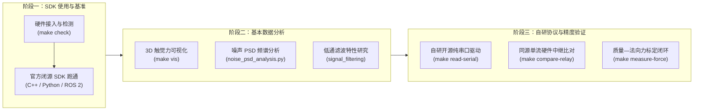

# Contactile PTS Lab

Ubuntu 24.04 x86_64 环境下 Contactile PTS（PapillArray）触觉传感器的软硬件实验平台。

本项目围绕三项核心任务主线递进构建：
**[阶段一] 传感器 SDK 使用 ➔ [阶段二] 基本数据分析 ➔ [阶段三] 自研协议确保准确性**。



---

## 3 分钟快速上手 (Quick Start)

```bash
# 1. 首次克隆并初始化 ROS2 子模块
git clone --recurse-submodules git@github.com:langxin11/contactile_pts_lab.git
cd contactile_pts_lab

# 2. 一键配置环境（编译 C++、配置 Python 3.10 环境、拉取子模块）
make setup

# 3. 检查硬件连接与串口权限
make check

# 4. 实时读取触觉传感器数据（自研纯串口协议，开箱即用）
make read-serial
```

---

## 核心任务主线指南

### 阶段一：传感器 SDK 使用与基准确立

掌握原厂 C++、Python、ROS 2 三条技术链路，确立官方闭源算法基准（Baseline）。

| 链路 | 入口命令 | 驱动底层 | 适用场景 |
|:---|:---|:---|:---|
| **C++ SDK** | `make read-cpp` | `libPTSDK.a` 静态库 | 极低延迟控制、嵌入式部署 |
| **Python SDK** | `make read-sdk` | 原厂 `cp310` wheel | 官方算法复现、三维力矩基准对比 |
| **ROS 2** | `make run-ros2` | `contactile-papillarray-ros2` (Jazzy) | 机械臂末端集成、机器人闭环控制 |

> **为什么提供两种 Python 驱动？**
> - **官方 SDK 链路** (`quick_read_sdk.py`)：调用原厂预编译 C++ 扩展，包含官方力与滑移估计黑盒，但锁死在 Python 3.10 和 x86_64 架构。
> - **自研串口驱动** (`quick_read_serial.py`)：纯 Python 解析 PTS 二进制数据包，免编译、支持 Python 3.10+、完美适配 Ubuntu 24.04 与 ARM 架构（如树莓派、Jetson），高刷新无额外开销。

### 阶段二：基本数据分析与物理特性

探索传感器物理特性，研究噪声本底与动态响应：

1. **实时 3D 触觉力可视化**：
   ```bash
   make vis
   ```
   启动基于 DearPyGui 的轻量级可视化面板，实时渲染 3×3 柱阵列形变与局部 3D 受力。
2. **本底噪声与功率谱密度 (PSD) 分析**：
   ```bash
   make noise-psd CSV=data/protocol_compare/<会话目录>/protocol.csv
   ```
   分析静止无负载下的噪声频段分布，定量指导一阶数字滤波器的截止频率 $f_c$ 选择。详见 [噪声 PSD 实验手册](docs/experiments/noise_psd.md)。
3. **信号滤波理论**：
   详阅 [传感器电气特性与低通滤波笔记](docs/notes/signal_filtering.md)。

### 阶段三：自研协议开发与准确性闭环

为了摆脱原厂闭源黑盒与运行平台限制，本项目研发了纯串口二进制通信驱动，并通过严密的**同源双轨实验**确保自研协议的准确性达到工业级水准：

1. **同源单流硬件中继比对 (Twin Relay)**：
   ```bash
   make compare-relay
   ```
   `pts_protocol_compare.py` 打开物理串口读取字节，**同一批原始数据流同时中继给官方 SDK 并喂入自研协议解析器**。在同一次物理放置、同一时间窗口下进行零时钟抖动比对，彻底消除人为放置误差。
2. **质量—法向压力标定与测量**：
   ```bash
   make measure-force
   ```
   引导式阶梯加载测量，支持终端撤销（`u`）、排除（`d <ID>`），并在测试结束后自动调用 IEEE 规范的绘图脚本。详见 [质量标定实验手册](docs/experiments/force_accuracy.md)。
3. **单元测试与协议校验**：
   ```bash
   make test
   ```

---

## 统一任务速查表 (Makefile)

根目录下提供了标准的任务流水线命令，免去频繁进入子目录或记忆长参数的烦恼：

| 命令 | 阶段 / 类别 | 功能说明 |
|:---|:---|:---|
| `make check` | 设备检查 | 检查 USB 硬件连接与 dialout 权限 |
| `make setup` | 环境配置 | 一键拉取子模块、编译 C++ 并安装 Python 依赖 |
| `make read-serial` | 阶段三 (推荐) | [Python] 运行自研纯串口协议实时读取（全平台支持） |
| `make read-sdk` | 阶段一 | [Python] 运行官方 SDK 读取基准 |
| `make read-cpp` | 阶段一 | [C++] 编译并运行官方极简 C++ 读取器 |
| `make run-ros2` | 阶段一 | [ROS2] 启动 ROS 2 触觉发布节点 |
| `make vis` | 阶段二 | 启动 DearPyGui 3D 触觉力与形变实时可视化 GUI |
| `make noise-psd` | 阶段二 | 运行空载噪声本底与 PSD 功率谱密度分析 (`CSV=...`) |
| `make measure-force`| 阶段三 | 启动质量—法向压力阶梯标定测量 |
| `make compare-relay`| 阶段三 | 启动官方 SDK vs 自研协议同源实时中继双轨比对 |
| `make test` | 质量保证 | 运行 Python 工作区完整单元测试套件 |
| `make docs` | 文档手册 | 编译 Sphinx HTML 手册并输出本地预览链接 |
| `make clean` | 缓存清理 | 清除编译构建与临时生成物 |

---

## 本地完整文档体系 (Sphinx)

本项目配套有体系化的技术笔记与原厂规格书中文拆解：

```bash
make docs
# 或启动热预览服务:
bash scripts/build_docs.sh --serve
```

文档涵盖：
- [产品概述与传感器规格](docs/notes/sensor_overview.md)
- [通信协议详解 (PTSCOM 规范拆解)](docs/notes/communication_protocol.md)
- [C++ Linux SDK 使用笔记](docs/notes/cpp_sdk_guide.md)
- [Python SDK 使用与兼容笔记](docs/notes/python_sdk_guide.md)
- [ROS 2 集成与架构说明](docs/notes/ros2_integration.md)
- [质量—法向压力实验手册](docs/experiments/force_accuracy.md)
- [噪声 PSD 分析手册](docs/experiments/noise_psd.md)

---

## 硬件连接与配置速查

| 参数 | 默认值 | 说明 |
|:---|:---|:---|
| `port` | `/dev/ttyACM0` | 传感器虚拟串口设备路径 |
| `baud_rate` | 9600 (C++/ROS2/SDK) / 115200 (Python自研) | 串口波特率 |
| `sensor_count` | 1 | 连接的传感器数量（单个控制器最多支持 2 个） |
| `bias_on_startup` | true | 启动时自动进行零点校准（**必须确保传感器空载**） |

### 串口权限设置

```bash
sudo usermod -aG dialout $USER
# 注销并重新登录系统生效
```

---

## 常见故障排查 (Troubleshooting)

| 故障现象 | 潜在原因 | 推荐排查方案 |
|:---|:---|:---|
| **设备打不开 / Permission denied** | 未加入 dialout 组或串口被其他进程占用 | 运行 `make check`；若被占用，使用 `fuser -v /dev/ttyACM*` 排查残留进程 |
| **无负载时读数不为 0** | 零点校准（Bias）时传感器表面受压或有重物 | 移除表面一切接触，重新运行读取命令或调用 reset bias |
| **Python import ptsdk 失败** | 未在 Python 3.10 环境或 wheel 未安装 | 运行 `make setup` 或检查 `python_ws/.python-version` 是否为 3.10 |
| **colcon build 找不到 catkin_pkg** | uv 虚拟环境中的 Python 污染了 ROS2 构建路径 | 编译时追加 `-DPython3_EXECUTABLE=/usr/bin/python3` |
